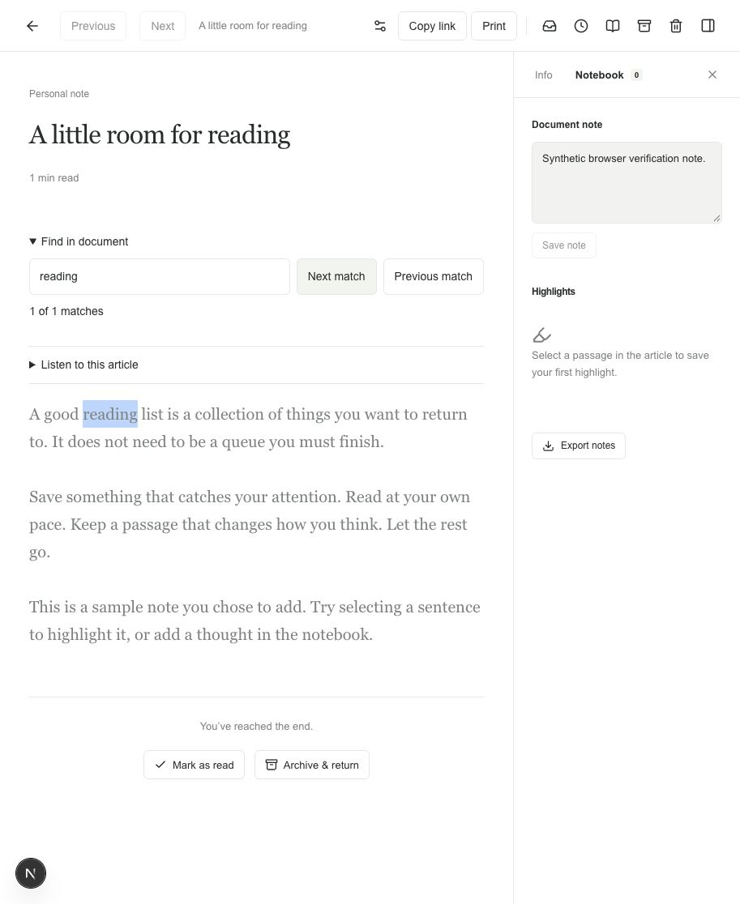
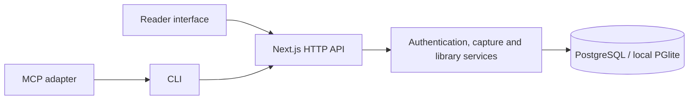

<p align="center">
  
</p>

<h1 align="center">Margin</h1>

<p align="center"><strong>A malleable reading space. Clean by design. Built to work with agents.</strong></p>

<p align="center">
  <a href="#get-started">Get started</a> ·
  <a href="docs/site/pages/index.md">Handbook</a> ·
  <a href="docs/site/pages/architecture/overview.md">Architecture</a> ·
  <a href="docs/site/pages/development/agents.md">For agents</a>
</p>

Margin is a self-hosted reading space for articles, feeds, PDFs and EPUBs. Collect what interests you, read without clutter, and keep your notes beside the passages that matter.

The purpose is to make a reader you can shape around your own habits. Configure the reading workflow, create views over your library, connect your tools, or work with an agent to change the application itself. Your data stays portable, and the architecture is documented so the next change has a clear place to begin.

**Architected and delivered with [pstack](https://github.com/michael-denyer/pstack-claude) and [Impeccable](https://impeccable.style/).**



## A reader you can make your own

Malleability starts with everyday choices. Pick a Triage, Shortlist or Classic workflow. Adjust the type, reading width, theme and keyboard shortcuts. Pin a saved query such as `tag:research AND minutes__lt:10` to make a collection that changes with your library.

It extends to the code. Margin brings the interface, domain model, storage and tool adapters into one repository. You can inspect how a feature works and adapt it with an agent. The [handbook](docs/site/pages/index.md) explains both the product and the boundaries a change must preserve.

The design keeps reading central: restrained color, generous spacing, readable type and a notebook alongside the text.

## What you can do today

| | In Margin |
| --- | --- |
| Collect | Save public articles or pasted text; upload PDFs and EPUBs |
| Follow | Subscribe to RSS and Atom feeds, including supported podcast enclosures and YouTube channel entries |
| Organize | Use workflow folders, tags, favorites, bulk actions and saved boolean queries |
| Read | Adjust the reader, keep your place, find passages and listen with system speech |
| Remember | Highlight text, add notes and revisit annotations in the notebook |
| Keep your library | Import and export JSON, CSV, OPML and ZIP archives with original files |
| Connect tools | Search and read through the CLI or MCP; save URLs with a separate capture credential |

See the [feature guide](docs/site/pages/guide/features.md) for supported behavior and limits.

## Agent-friendly architecture

Agents can work with Margin in two ways: use scoped tools to read a library, or work on the source to adapt the product.

The local MCP adapter exposes `margin_list`, `margin_search` and `margin_read`. The CLI also supports URL capture. Read and capture tokens have separate permissions; a read token cannot change documents or download originals.

For development, typed domain records, explicit server boundaries and behavior tests make changes easier to reason about. The documentation includes an agent guide, individual Markdown exports, `llms.txt` and a complete `llms-full.txt` bundle.



The application uses Next.js, React and TypeScript. PostgreSQL holds production data; PGlite makes local development possible without a database service. Each account's library is currently one JSONB aggregate, with originals stored separately. The [architecture guide](docs/site/pages/architecture/overview.md) explains that tradeoff and its scaling limits.

[Connect an MCP client](docs/site/pages/reference/mcp.md) · [Use the CLI](docs/site/pages/reference/cli.md) · [Read the API contract](docs/site/pages/reference/api.md)

## Built with pstack and Impeccable

Margin is also an exercise in building personal software with agents. pstack provides the engineering workflow for architecture, implementation and review. Impeccable provides the design guidance for hierarchy, typography, interaction and visual consistency.

That approach carries into the repository: readable documentation, testable behavior and clear constraints for future changes. Neither tool is required to run Margin.

## Get started

Use Node.js 22.3 or newer and npm.

```sh
git clone https://github.com/mklew/reading-space-by-margin.git
cd reading-space-by-margin
npm ci
cp .env.example .env.local
node -e "console.log(require('node:crypto').randomBytes(32).toString('hex'))"
```

Set `SETUP_SECRET` in `.env.local` to the generated value. Leave `DATABASE_URL` unset to use local PGlite storage, then start the app:

```sh
npm run dev
```

Open [localhost:3000](http://localhost:3000), enter the setup code and create your personal account with a separate password. Run only one app process against the local data directory.

For a hosted installation, follow the [deployment guide](docs/site/pages/guide/deployment.md). Production requires PostgreSQL and its own secrets.

## Explore the handbook

The VitePress handbook covers the product, reading workflows, deployment, architecture and development. It has local search, light and dark themes, and Markdown exports for agents.

```sh
npm --prefix docs/site ci
npm run docs:dev
```

| Start here | What you will find |
| --- | --- |
| [Product overview](docs/site/pages/guide/product.md) | Purpose, vocabulary and the everyday reading loop |
| [Reading workflow](docs/site/pages/guide/reading.md) | Folders, views, notes and shortcuts |
| [Architecture](docs/site/pages/architecture/overview.md) | Components, data flow and design decisions |
| [Agent guide](docs/site/pages/development/agents.md) | Source map, invariants and validation |
| [Contributing](CONTRIBUTING.md) | Development setup and contribution guidance |
| [Security](SECURITY.md) | Credential handling, privacy boundaries and reporting |

## Status and boundaries

Margin is an active MVP with one account per installation. Agent access is available through its tools; built-in AI chat and summaries are not implemented. Offline synchronization, public sharing, OCR and full-fidelity book rendering remain future work.

Uploads have a 4 MB request limit. Large libraries and archives need further scaling work. The server can read stored library content; storage is not end-to-end encrypted. Keep secrets, local databases and private exports out of Git.

Validate application changes with:

```sh
npm run typecheck
npm test
npm run build
```

Build the handbook with `npm run docs:build`. Tests use isolated databases and synthetic documents. See [testing and verification](docs/site/pages/development/testing.md) for coverage and limits.

Margin is an independent project inspired by Readwise Reader, with no affiliation to Readwise.
